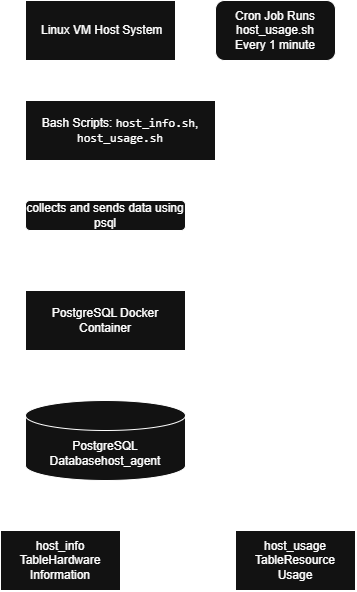

# Linux Cluster Monitoring Agent

## Introduction

The Linux Cluster Monitoring Agent is a small monitoring solution built to collect and store information about a Linux server. It captures details about the system hardware, along with resource usage such as memory, CPU activity and disk space.

The project uses Bash scripts to collect the information, PostgreSQL to store it, and Docker to run the database. A cron job runs the usage collection script every minute, allowing the system to record resource usage over time without requiring manual execution.

The collected information is stored in two relational tables: `host_info` and `host_usage`. SQL queries can then be used to review and analyze the monitoring data.

## Quick Start

### Prerequisites

Make sure the following tools are installed on the Linux machine:

- Linux operating system
- Docker
- PostgreSQL client (`psql`)
- Bash
- `vmstat` and `lscpu`
- Git

### 1. Clone the Repository

```bash
git clone git@github.com:jarviscanada/jarvis_data_eng_VanitaBhagwani.git
cd jarvis_data_eng_VanitaBhagwani/linux_sql
```

### 2. Start the PostgreSQL Docker Container

Use the `psql_docker.sh` script to create the PostgreSQL container:

```bash
bash scripts/psql_docker.sh create postgres password
```

The script creates a Docker volume named `pgdata` to keep database files persistent.

### 3. Create the Database

Connect to PostgreSQL:

```bash
export PGPASSWORD=password
psql -h localhost -p 5432 -U postgres
```

Create the database:

```sql
CREATE DATABASE host_agent;
```

Exit the PostgreSQL prompt:

```sql
\q
```

### 4. Create the Database Tables

Run the DDL script to create the required tables:

```bash
psql -h localhost -p 5432 -U postgres -d host_agent -f sql/ddl.sql
```

### 5. Collect Host Information

Run `host_info.sh` to collect the server's hardware information and insert it into the database:

```bash
bash scripts/host_info.sh localhost 5432 host_agent postgres password
```

### 6. Collect Host Usage

Run `host_usage.sh` to collect the current resource usage:

```bash
bash scripts/host_usage.sh localhost 5432 host_agent postgres password
```

### 7. Schedule Automatic Data Collection

Open the crontab editor:

```bash
crontab -e
```

Add the following entry, replacing the path with the actual location of your project:

```bash
* * * * * bash /home/vanitabhagwani95/jarvis_data_eng_VanitaBhagwani/linux_sql/scripts/host_usage.sh localhost 5432 host_agent postgres password > /tmp/host_usage.log
```

This runs the usage collection script every minute and redirects its output to a log file.

**Note:** The commands above use example credentials for demonstration. Do not commit real database passwords to GitHub.

## Implementation

### Architecture

The monitoring agent runs on a Linux virtual machine. Bash scripts collect hardware and resource usage information and send it to a PostgreSQL database running inside a Docker container.

The `host_info.sh` script collects hardware information and registers the host in the database. The `host_usage.sh` script collects resource usage and inserts a new record every time it runs. Cron automates the execution of the usage script at one-minute intervals.



### Scripts

#### 1. psql_docker.sh

This script manages the PostgreSQL Docker container. It supports three commands:

- `create`: Creates the Docker volume and PostgreSQL container.
- `start`: Starts an existing PostgreSQL container.
- `stop`: Stops the running PostgreSQL container.

The script also checks whether Docker is running and whether the container already exists before performing the requested operation.

**Usage:**

```bash
bash scripts/psql_docker.sh create|start|stop [username] [password]
```

#### 2. host_info.sh

This script collects hardware information from the Linux machine using `lscpu`, `/proc/meminfo` and other system commands.

The information collected includes:

- Hostname
- Number of CPUs
- CPU architecture
- CPU model
- CPU frequency
- L2 cache size
- Total memory
- Collection timestamp

Before inserting the information, the script checks whether the hostname already exists in `host_info`. This prevents the same host from being registered more than once.

**Usage:**

```bash
bash scripts/host_info.sh localhost 5432 host_agent postgres password
```

#### 3. host_usage.sh

This script collects current resource usage information from the Linux machine.

It uses `vmstat` and `df` to collect:

- Free memory
- CPU idle percentage
- CPU kernel percentage
- Disk I/O
- Available disk space
- Collection timestamp

The script retrieves the host ID from `host_info` using the machine's hostname. It then inserts the collected usage information into `host_usage`.

If the host has not been registered in `host_info`, the script exits with an error.

**Usage:**

```bash
bash scripts/host_usage.sh localhost 5432 host_agent postgres password
```

#### 4. Crontab

Cron is used to automate resource monitoring. The `host_usage.sh` script is scheduled to run every minute.

```bash
* * * * * bash /home/vanitabhagwani95/jarvis_data_eng_VanitaBhagwani/linux_sql/scripts/host_usage.sh localhost 5432 host_agent postgres password > /tmp/host_usage.log
```

This allows the database to collect usage records continuously without manually running the script.

#### 5. queries.sql

This file contains SQL queries used to analyze the collected monitoring data.

The current query calculates the average memory usage percentage for each host over five-minute intervals. It joins `host_info` and `host_usage` using the host ID and groups the results by hostname and time interval.

## Database Modeling

The project uses a relational database with two tables: `host_info` and `host_usage`.

### host_info

This table stores hardware information about each monitored host.

| Column | Description |
|---|---|
| id | Unique identifier for each host |
| hostname | Hostname of the Linux machine |
| cpu_number | Number of CPUs |
| cpu_architecture | CPU architecture |
| cpu_model | CPU model name |
| cpu_mhz | CPU frequency in MHz |
| l2_cache | L2 cache size |
| total_mem | Total system memory |
| timestamp | Time when host information was collected |

The `id` column is the primary key, and `hostname` is unique so that a host is registered only once.

### host_usage

This table stores resource usage information collected from each host.

| Column | Description |
|---|---|
| timestamp | Time when usage was collected |
| host_id | References the corresponding host in `host_info` |
| memory_free | Available free memory |
| cpu_idle | CPU idle percentage |
| cpu_kernel | CPU kernel percentage |
| disk_io | Disk I/O information |
| disk_available | Available disk space |

The `host_id` column is a foreign key referencing `host_info.id`. Each usage record is associated with a registered host.

## Test

The scripts were tested on a Linux virtual machine with PostgreSQL running inside Docker.

The following checks were performed:

- Created and started the PostgreSQL Docker container.
- Verified that the PostgreSQL database was accessible using `psql`.
- Executed `ddl.sql` and checked that both tables were created.
- Ran `host_info.sh` and verified that hardware information was inserted into `host_info`.
- Ran `host_usage.sh` and checked that resource usage records were inserted into `host_usage`.
- Verified that repeated executions of `host_info.sh` did not create duplicate host entries.
- Configured cron and checked that usage records were being collected automatically.

## Deployment

The monitoring agent was deployed on a Linux virtual machine hosted on Google Cloud.

PostgreSQL runs inside a Docker container, with a persistent Docker volume used to retain database files. The Bash scripts execute on the Linux host and connect to PostgreSQL through port `5432`.

The initial hardware information is collected by running `host_info.sh`. After the host is registered, `host_usage.sh` runs every minute through cron and stores the latest resource usage information in the database.

## Improvements

There are several ways this project could be improved:

1. **Better error handling:** Add more detailed checks for database connectivity, missing commands and failed SQL operations.
2. **Secure credentials:** Store database credentials in a protected configuration file or another secure credential management solution instead of passing passwords directly through command-line arguments.
3. **Monitoring and alerts:** Add alerts when CPU, memory or disk usage crosses predefined thresholds.
4. **Historical data management:** Introduce a data retention policy to archive or remove older usage records and prevent unnecessary database growth.
5. **Hardware change detection:** Update host information when a machine's hardware configuration changes instead of only checking whether the hostname already exists.
